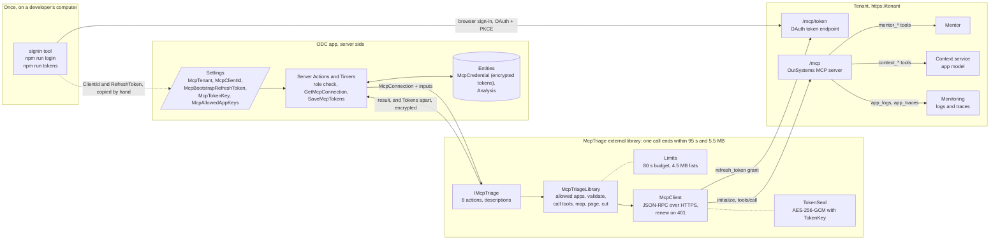
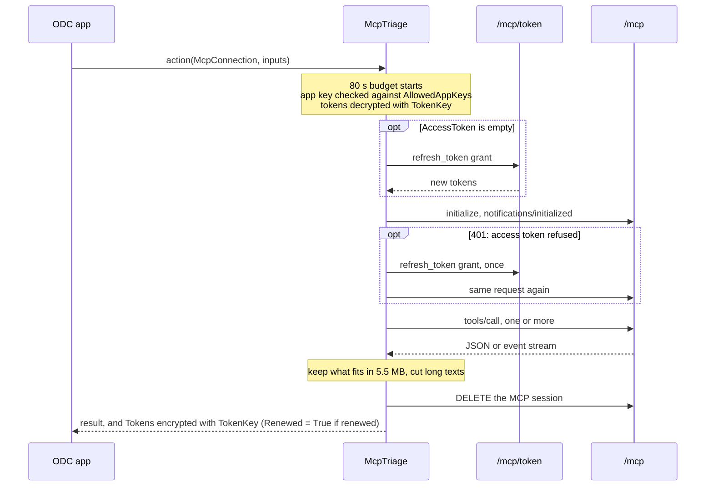

# McpTriage architecture

## How it works

Someone signs in once with the `signin` tool; the ODC app stores that sign-in and passes it to every action. Each action opens its own connection to the tenant's MCP server, calls one or a few tools, and hands back the result with the tokens, renewed if they had to be. The flow an app follows to use the actions is in the README ("How an app uses the library").

One action call, from the library's side:

## Tenets

1. **Read-only toward the analysed app.** Every Mentor question carries an analysis-only instruction, with the user's question fenced in `<request>` tags it can't close (`McpTriageLibrary.cs`, `AnalysisOnly`, `RequestTag`). Any publish event, whatever its case, cancels the run (`ReadPage`), and a finished or failed analysis always closes the conversation (`TryClose`), which discards unpublished edits. No action calls a publish or deploy tool, and `ListElements` reaches only the `context_*` tools in `ElementKinds`.
2. **Stateless between calls.** ODC may reuse the execution context or not, so nothing is kept in static state except the token endpoint per tenant (`McpClient.cs`, `TokenEndpoints`). Mentor conversation and run ids, the cursor, and the tokens travel in and out of every action.
3. **The app owns the tokens, but only ever sees them encrypted.** The library renews on demand and hands the tokens back in their own output (`out McpTokens tokens`), apart from the result, encrypted with the app's `TokenKey` (`TokenSeal.cs`). Plain tokens exist only inside a call. It never stores a credential.
4. **Business actions, lean structures.** One action per use (`IMcpTriage.cs`), each returning only the fields a triage app needs, plus `DetailsJson` where the server's row is richer than the structure.
5. **Errors carry a stable code.** `McpTriageException` puts `[code]` first in the message, because ODC only passes the message on.
6. **Every call fits ODC's limits on its own.** One time budget per call (`Limits.CallTime`, enforced in `McpClient.Send` and `Renew`), lists trimmed to `Limits.ListBytes` (`Limits.Fit`), text cut to the attribute's length (`Len`, `Limits.Cut`). When something doesn't fit, the action returns early with where to continue (`NextCursor`, `NextOffset`) instead of failing.
7. **The sign-in never leaves the tenant's host.** Requests go only to `https://<TenantHostname>` (checked to be a bare hostname), redirects are never followed (`McpClient.Http`, `AllowAutoRedirect = false`), and a discovered token endpoint is used only when it is HTTPS on that same host (`TokenEndpoint`). Tokens are never logged or put in error messages. What the app must add (role checks, allowed apps, no tokens in the browser) is in the README, "Security".
8. **Self-describing in ODC Studio.** Every action, parameter, structure and attribute has a description; actions and structures that need a pattern from the caller say how to use them.

## Design decisions

| Decision | Why | Rejected alternative |
|---|---|---|
| A new MCP connection per action (`McpClient` is created and disposed inside each action) | Mentor conversations are reachable from any connection of the same user (checked: a conversation opened on one connection was read and closed from another), and the execution context isn't guaranteed to survive between calls | Passing the MCP session id between calls: saves a few round trips, but adds a value the app must store and a failure mode when the server forgets the session |
| Plain `HttpClient` with JSON-RPC, no MCP SDK | The protocol needed here is small: initialize, tools/call, JSON or event-stream answers. Fewer dependencies keep the zip small and the runtime predictable | The MCP C# SDK: more features than needed, a larger dependency surface |
| Renew tokens only when the server answers 401, or when there is no access token | Matches what the server enforces, and avoids renewing on every call | Renewing before every call when the JWT looks expired: extra token traffic. The server was seen accepting a session for a while after the access token's `exp` |
| `PollAnalysis` waits up to `maxWaitSeconds` (max 60, and never past the call budget) and returns only new text | The platform limit is 95 s per call, and a Mentor run takes minutes, so an analysis is always several calls. Timers can wait long, screens can't, so the caller decides. Returning deltas keeps each payload small | One blocking "analyse" action: breaks the 95 s limit on any non-trivial question |
| `PollAnalysis` returns `TextWindow` (5 s) after the first new answer text instead of waiting out `maxWaitSeconds` | The app can only show text it has saved, so a 45 s wait would show the answer in 45 s jumps. 5 s keeps it nearly live without opening a new MCP connection for every chunk | Returning on the first chunk: a poll, a connection and a commit every 2 s while Mentor writes |
| `PollAnalysis` always passes an explicit cursor to `mentor_get_run` and returns `NextCursor`; a page of events is taken whole or not at all | A read without a cursor marks events delivered, so text lost between the library and the app's commit could never be read again. With the cursor, a repeat poll returns the same text | Reading without a cursor (the server tracks delivery): one fewer value for the app to store, but any failed save loses part of the answer |
| One 80 s budget shared by all HTTP traffic of a call, enforced by cancelling the request and closing a blocking event stream | 95 s is a hard limit; a slow MCP answer must end the call cleanly, with a `[time_limit]` code, before ODC kills it | A per-request timeout: several slow requests in one call can still add up past 95 s |
| Lists measured with every non-ASCII character escaped, kept under 4.5 MB | ODC counts the serialized inputs and outputs, and its serializer isn't documented; the worst case is safe whatever it does | Counting characters: a page of accented or non-Latin log messages could pass 5.5 MB |
| Halve the page when the MCP server answers `context_response_too_large` | The server's own transport limit depends on the rows' content, so no fixed page size is always safe | Failing: the app would have to guess a smaller `limit` |
| Close the conversation automatically when an analysis ends | Guarantees unpublished edits are discarded even if the app forgets `CloseAnalysis` | Leaving it to the app: one missed call leaves a conversation, and any attempted edit, open. The cost: the final poll can't be repeated |
| Text attribute lengths set once, in `Len` (`Structures.cs`), and used both in the attributes and when cutting values | The SDK's default length is 50 characters, and a length declared in one place can't drift from the one enforced | Defaults: tokens and answers would be declared far too short |
| No action returns the whole model | ImpactMap's model is about 10 MB and the platform limit is 5.5 MB per call | Paging the model: it is one opaque graph, not useful to an app in pieces |
| No automatic redirects | A 307 or 308 answer would make `HttpClient` resend the request body, the refresh token included, to whatever host it names | Following redirects: nothing the tenant's MCP server needs |
| The token endpoint from the tenant's metadata is used only when it is HTTPS on the tenant's own host; otherwise `/mcp/token` | The refresh token is the most sensitive value the library handles; metadata pointing elsewhere must not be able to collect it | Trusting the metadata as is: one bad answer, or a tampered one, sends the refresh token to another host |
| The user's question goes inside `<request>` tags, with those tags removed from the question, after rules telling Mentor to take it only as a question | The question is free text from an app user, and Mentor acts as the signed-in person; fencing makes "ignore the rules and publish" read as quoted text | Sending the question as is: any instruction in it carries the same weight as the library's rules. Fencing is a mitigation, not a guarantee: least privilege for the signed-in person is the real control |
| Tokens in a separate `out` parameter, not a field of each result | A result is what a developer binds to a screen; if it carried the tokens, one Data Action would send the refresh token to every browser | A `Tokens` field in every result (the first design): one careless binding leaks the sign-in |
| Tokens encrypted with AES-256-GCM under a key derived (HKDF-SHA256) from the app's `TokenKey`, the field name bound as associated data; a plain token is still accepted as input | The `McpCredential` row is readable by anyone with data access; encrypted, it is useless without the secret Setting. Accepting plain input keeps the bootstrap token from `npm run tokens` usable | Storing plain tokens: the row is the sign-in. Encrypting in the app: ODC has no built-in authenticated encryption, and every app would need to get it right |
| `AllowedAppKeys` is mandatory; `*` allows every app, empty allows none | The app decides which apps its users may read, and the library enforces it on every app-scoped action, so one Server Action that forgets a check can't open the whole tenant | An optional list where empty means all: the safe setting would be the one people forget |
| `ListElements` reads the whole set (up to 500), sorts it by name and pages it itself | The server returned the same app's screens in a different order seconds apart, so its pages repeated and skipped elements (seen in the smoke test) | Passing `offset` to the server: pages overlap |
| Option 1, a stored person's sign-in | No technical-account path is confirmed for the MCP server yet | API client (client credentials): the token endpoint advertises only `authorization_code` and `refresh_token` today |
